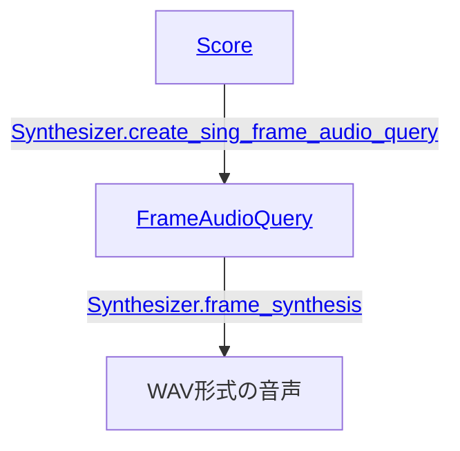
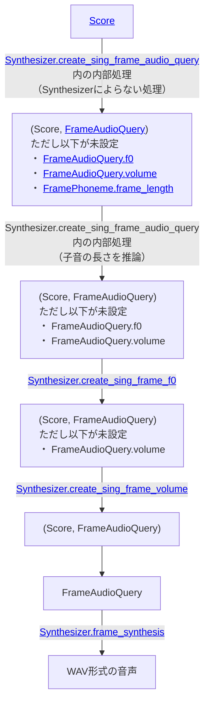

# 歌唱音声合成

[VOICEVOX コア ユーザーガイド]と同じ手順で環境構築ができているものとします。

歌唱音声合成を行うためにはまず[`Score`]（楽譜）を用意します。

```py
from voicevox_core import Note, Score

score = Score(
    [
        Note(15, ""),
        Note(45, "ド", key=60),
        Note(45, "レ", key=62),
        Note(45, "ミ", key=64),
        Note(15, ""),
    ],
)
```

Rust API, C API, Java APIでは`Score`は以下のようなJSONで表現できます。

```json
{
  "notes": [
    { "key": null, "frame_length": 15, "lyric": "" },
    { "key": 60, "frame_length": 45, "lyric": "ド" },
    { "key": 62, "frame_length": 45, "lyric": "レ" },
    { "key": 64, "frame_length": 45, "lyric": "ミ" },
    { "key": null, "frame_length": 15, "lyric": "" }
  ]
}
```

`Score`中の[`Note`]には音符と休符があります。[`Score.notes`]の最初のノートは休符にします。

[`Note.lyric`]と[`Note.key`]に次の値を設定します。

- 音符の場合:
    - `Note.lyric`: 一つのモーラを表すひらがな/カタカナで歌詞を設定（例: `"ド"`, `"ファ"`）。
    - `Note.key`: MIDIのnote numberで音階を設定（例: C4なら`60`）。
- 休符の場合:
    - `Note.lyric`: 空文字列を設定。
    - `Note.key`: `null`/`None`を設定。

[`Note.frame_length`]には、秒数に93.75をかけて端数を調整したものを設定します。
（例: 125BPM (_**B**eats **P**er **M**inute_)における一拍は、93.75\[フレーム/秒\] / (125\[拍/分\] / 60\[秒/分\]) = `45`\[フレーム/拍\]）。

[`Synthesizer.create_sing_frame_audio_query`]で`Score`から[`FrameAudioQuery`]を生成します。
指定できる`style_id`は、[種類]が`"singing_teacher"`か`"sing"`であるスタイルの`id`です。

```py
SINGING_TEACHER = 6000  # 波音リツ（ノーマル）
frame_audio_query = synthesizer.create_sing_frame_audio_query(
    score, SINGING_TEACHER
)
```

[`Synthesizer.frame_synthesis`]で音声合成してWAVデータを生成します。
`frame_synthesis`で指定できる`style_id`は、種類が`"frame_decode"`か`"sing"`であるスタイルの`id`です。

```py
SINGER = 3000  # 四国めたん（あまあま）
wav = synthesizer.frame_synthesis(frame_audio_query, SINGER)
```

## 前提知識: フレーム

歌唱音声合成では、時間を**フレーム**という単位で扱います。1フレームは1/93.75秒（約10.7ミリ秒）で、この値は`FRAME_RATE`として定義されています。出力されるWAVは24000Hzなので、1フレームは256サンプルにあたります。

`Score`と`FrameAudioQuery`はどちらもフレームを単位として長さを持ちます。

- [`Note.frame_length`]: そのノートが何フレーム続くか。
- [`FramePhoneme.frame_length`]: その音素が何フレーム続くか。
- [`FrameAudioQuery.f0`]/[`FrameAudioQuery.volume`]: **1要素が1フレーム**に対応する配列。

ノート列の合計フレーム数と音素列の合計フレーム数は一致し、`f0`と`volume`の長さもそれと同じになります。冒頭の`Score`の例なら、15 + 45 + 45 + 45 + 15 = 165フレーム（約1.76秒）です。

```
ノート列の合計フレーム数: 15 + 45 + 45 + 45 + 15             = 165
音素列の合計フレーム数:   13 + 2 + 39 + 6 + 40 + 5 + 45 + 15 = 165
f0の長さ:                                                       165
volumeの長さ:                                                   165
```

## フレームから見た全体像

`Score`から音声ができるまでを、フレームに注目して図にすると次のようになります。API単位の流れは[歌唱音声合成の流れ](#歌唱音声合成の流れ)を参照してください。

```
Score（ノート列）
  │  ① 子音の長さを推論し、ノート列を音素列に分割する
  ▼
FrameAudioQuery.phonemes（音素列）
  │  ② 音素列を1フレームずつに展開し、各フレームに「音素」と「その音素が属するノートの音高」を割り当てる
  ▼
フレームごとの (音素, 音高)
  │  ③ フレームごとの (音素, 音高) から f0 を推論する              … create_sing_frame_f0
  ▼
FrameAudioQuery.f0
  │  ④ フレームごとの (音素, 音高, f0) から volume を推論する       … create_sing_frame_volume
  ▼
FrameAudioQuery.volume
  │  ⑤ フレームごとの (音素, f0, volume) から波形を生成する          … frame_synthesis
  ▼
WAV形式の音声
```

①〜④は[`Synthesizer.create_sing_frame_audio_query`]の中でまとめて行われます。③と④だけをやり直したい場合は、[`Synthesizer.create_sing_frame_f0`]と[`Synthesizer.create_sing_frame_volume`]を使います。

### ②: フレームへの割り当て

各フレームには、そのフレームの音素と、**その音素が属するノート**の`key`が割り当てられます。休符の音素（`pau`）の`key`は「音高なし」として扱われます。

[子音の侵食](#子音の侵食)で後述するように、子音は一つ前のノートの時間に置かれます。それでも、子音の`key`は一つ前のノートのものではなく、**子音自身が属するノート**のものになります。冒頭の例の先頭部分は次のようになります。

| フレーム | 0〜12 | 13〜14 | 15〜53 | 54〜59 | … |
|---|---|---|---|---|---|
| ノート（時間上の位置） | 休符 | 休符 | ド | ド | … |
| 音素 | `pau` | `d` | `o` | `r` | … |
| 割り当てられる`key` | なし | `60`（ド） | `60`（ド） | `62`（レ） | … |

### ③と④: f0とvolumeの順番

`volume`の推論には`f0`を入力として使います。そのため、生成は必ず**`f0`→`volume`の順**になります。

`Score`や`FrameAudioQuery.phonemes`を編集した場合は、まず`create_sing_frame_f0`で`f0`を作り直し、その`FrameAudioQuery`を使って`create_sing_frame_volume`で`volume`を作り直してください。`f0`だけを手で調整した場合（後述の[音域調整](#音域調整)など）も、`volume`は`f0`を入力として推論されるため、作り直せば調整後の`f0`が音量に反映されます。

## 子音の侵食

`Score.notes`から`FrameAudioQuery.phonemes`を生成する際、`Note.lyric`は子音と母音に分割されます。このときの母音の開始位置は、ノートの開始位置と同じになるように調整されます。子音は母音より前に位置するため、子音は一つ前のノートを侵食します。

例えば冒頭の`Score`の例からは次のようにフレームが分割されます。

```json
{
  "phonemes": [
    { "phoneme": "pau", "frame_length": 13 },
    { "phoneme": "d", "frame_length": 2 },
    { "phoneme": "o", "frame_length": 39 },
    { "phoneme": "r", "frame_length": 6 },
    { "phoneme": "e", "frame_length": 40 },
    { "phoneme": "m", "frame_length": 5 },
    { "phoneme": "i", "frame_length": 45 },
    { "phoneme": "pau", "frame_length": 15 },
  ],
  …
}
```

図示するとこうなります。

```
    15                    45                             45                             45                   15
+----------+------------------------------+------------------------------+------------------------------+----------+
|          |              do              |              re              |              mi              |          | ノート列
+----------+------------------------------+------------------------------+------------------------------+----------+
.          .                              .                              .                              .          .
.          .                              .                              .                              .          .
.          .                              .                              .                              .          .
+--------+-+-------------------------+----+--------------------------+---+------------------------------+----------+
|        |d|            o            | r  |            e             | m |              i               |          | 音素列
+--------+-+-------------------------+----+--------------------------+---+------------------------------+----------+
    13    2             39             6               40              5                45                   15
```

## ノートID

`FrameAudioQuery`を生成するとき、[`Note.id`]の文字列が[`FramePhoneme.note_id`]にコピーされます。歌唱音声には影響しません。

## 音域調整

`singing_teacher`のスタイルと`frame_decode`のスタイルでは得意な音域が異なることがあります。その場合はうまく歌うために音域を調整します。この調整は[VOICEVOXエディタの音域調整機能]と同じ。

```py
KEY_RANGE_ADJUSTMENT = -4  # "四国めたん（あまあま）"の場合

for note in score.notes:
    if note.key is not None:
        note.key -= KEY_RANGE_ADJUSTMENT

frame_audio_query = synthesizer.create_sing_frame_audio_query(score, SINGING_TEACHER)

frame_audio_query.f0 = [
    f0 * 2 ** (KEY_RANGE_ADJUSTMENT / 12) for f0 in frame_audio_query.f0
]
```

## 歌唱音声合成の流れ

歌唱音声合成の流れを図にするとこのようになります。



詳細な流れは次になります。



[VOICEVOX コア ユーザーガイド]: ./usage.md
[`Score`]: https://voicevox.github.io/voicevox_core/apis/python_api/autoapi/voicevox_core/index.html#voicevox_core.Score
[`Score.notes`]: https://voicevox.github.io/voicevox_core/apis/python_api/autoapi/voicevox_core/index.html#voicevox_core.Score.notes
[`Note`]: https://voicevox.github.io/voicevox_core/apis/python_api/autoapi/voicevox_core/index.html#voicevox_core.Note
[`Note.lyric`]: https://voicevox.github.io/voicevox_core/apis/python_api/autoapi/voicevox_core/index.html#voicevox_core.Note.lyric
[`Note.key`]: https://voicevox.github.io/voicevox_core/apis/python_api/autoapi/voicevox_core/index.html#voicevox_core.Note.key
[`Note.frame_length`]: https://voicevox.github.io/voicevox_core/apis/python_api/autoapi/voicevox_core/index.html#voicevox_core.Note.frame_length
[`Note.id`]: https://voicevox.github.io/voicevox_core/apis/python_api/autoapi/voicevox_core/index.html#voicevox_core.Note.id
[`FrameAudioQuery`]: https://voicevox.github.io/voicevox_core/apis/python_api/autoapi/voicevox_core/index.html#voicevox_core.FrameAudioQuery
[`FramePhoneme.note_id`]: https://voicevox.github.io/voicevox_core/apis/python_api/autoapi/voicevox_core/index.html#voicevox_core.FramePhoneme.note_id
[種類]: https://voicevox.github.io/voicevox_core/apis/python_api/autoapi/voicevox_core/index.html#voicevox_core.StyleType
[VOICEVOXエディタの音域調整機能]: https://voicevox.hiroshiba.jp/how_to_use/#音域調整
[`Synthesizer.create_sing_frame_audio_query`]: https://voicevox.github.io/voicevox_core/apis/python_api/autoapi/voicevox_core/blocking/index.html#voicevox_core.blocking.Synthesizer.create_sing_frame_audio_query
[`Synthesizer.frame_synthesis`]: https://voicevox.github.io/voicevox_core/apis/python_api/autoapi/voicevox_core/blocking/index.html#voicevox_core.blocking.Synthesizer.frame_synthesis
[`FramePhoneme.frame_length`]: https://voicevox.github.io/voicevox_core/apis/python_api/autoapi/voicevox_core/index.html#voicevox_core.FramePhoneme.frame_length
[`FrameAudioQuery.f0`]: https://voicevox.github.io/voicevox_core/apis/python_api/autoapi/voicevox_core/index.html#voicevox_core.FrameAudioQuery.f0
[`FrameAudioQuery.volume`]: https://voicevox.github.io/voicevox_core/apis/python_api/autoapi/voicevox_core/index.html#voicevox_core.FrameAudioQuery.volume
[`Synthesizer.create_sing_frame_f0`]: https://voicevox.github.io/voicevox_core/apis/python_api/autoapi/voicevox_core/blocking/index.html#voicevox_core.blocking.Synthesizer.create_sing_frame_f0
[`Synthesizer.create_sing_frame_volume`]: https://voicevox.github.io/voicevox_core/apis/python_api/autoapi/voicevox_core/blocking/index.html#voicevox_core.blocking.Synthesizer.create_sing_frame_volume
